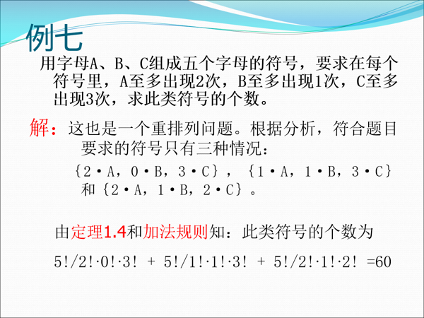
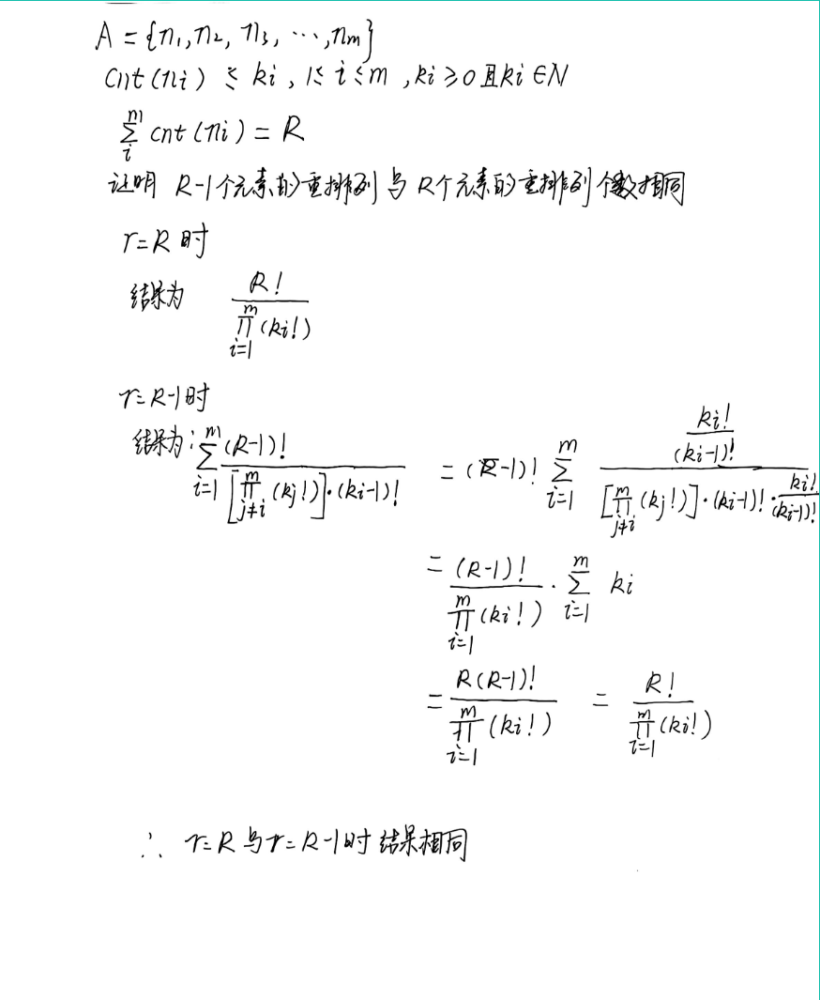
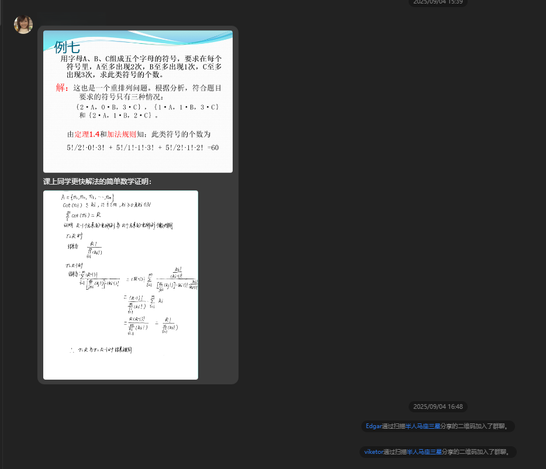
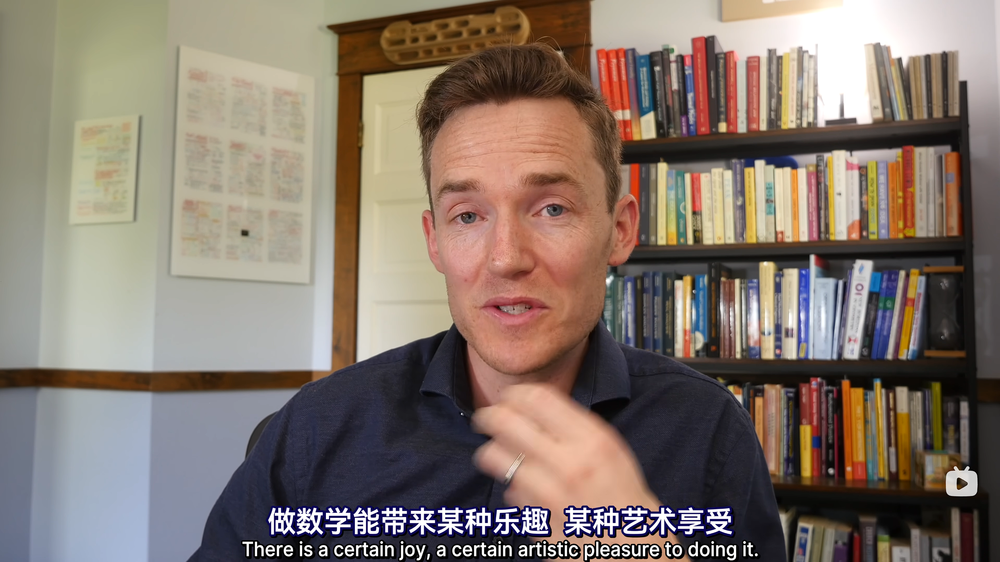
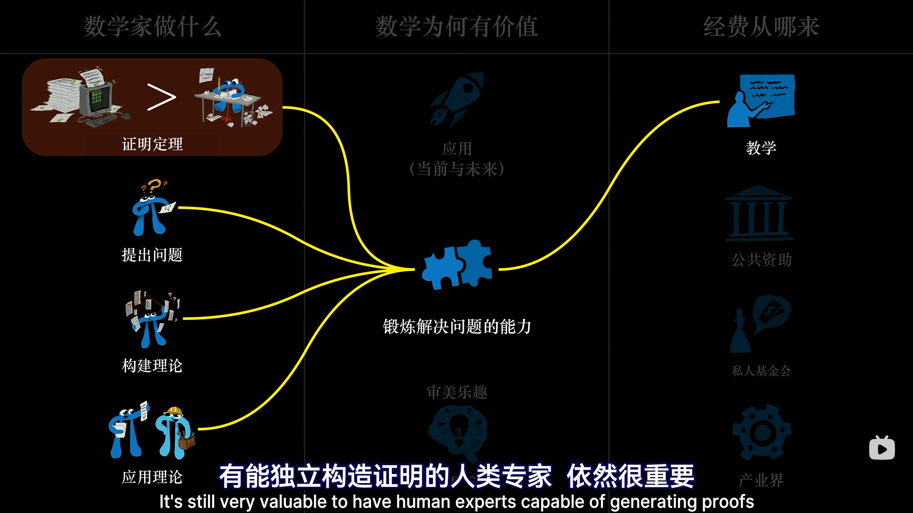
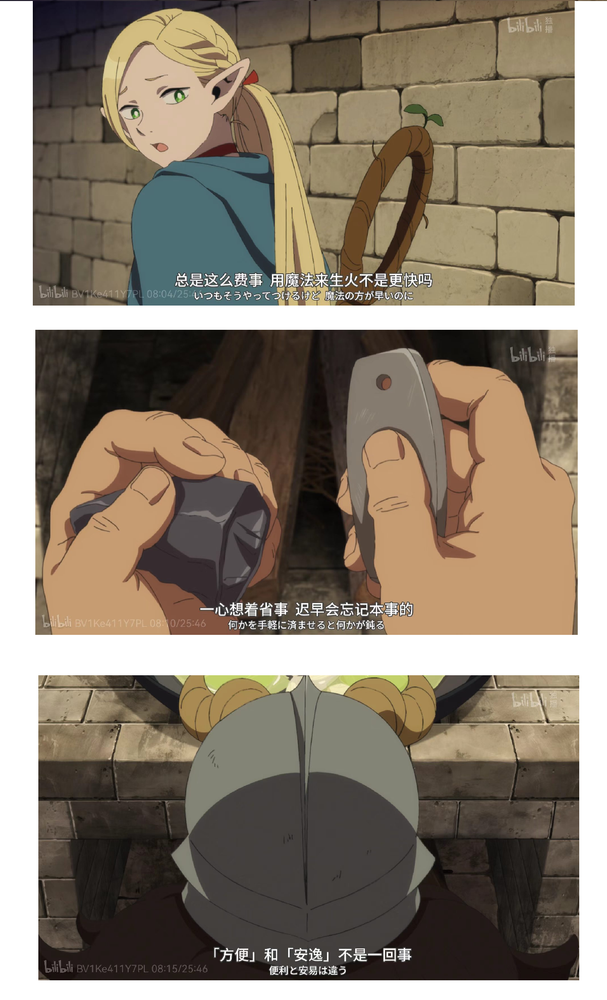
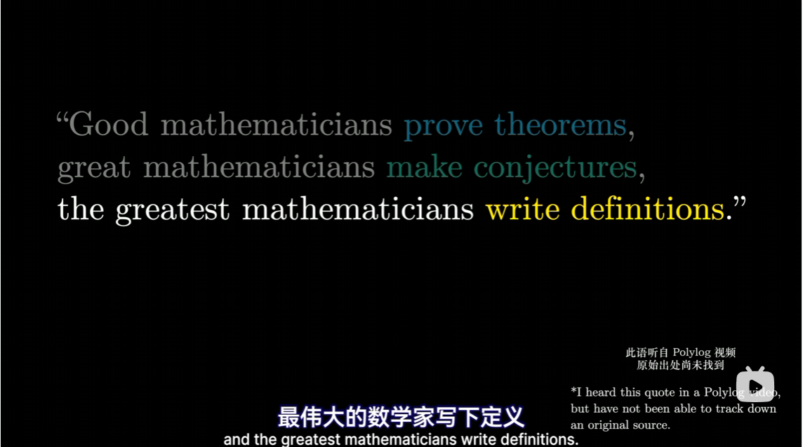
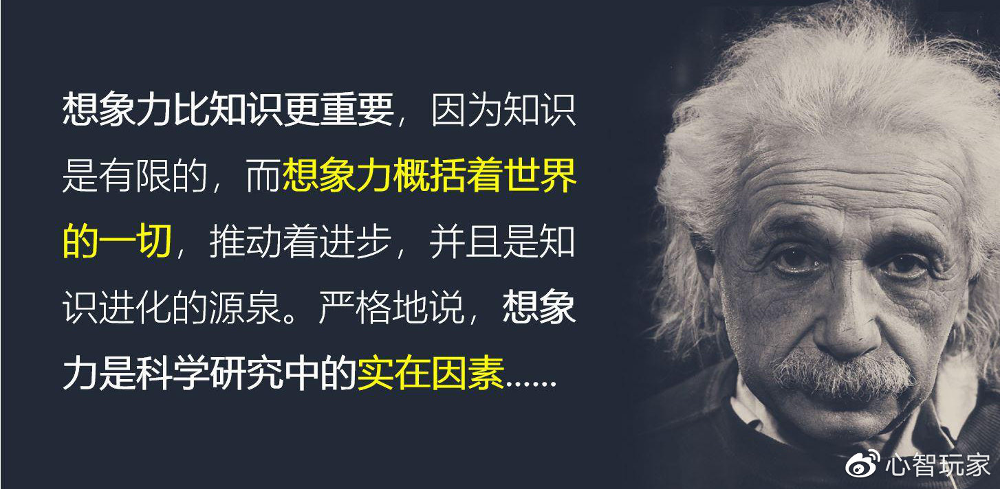
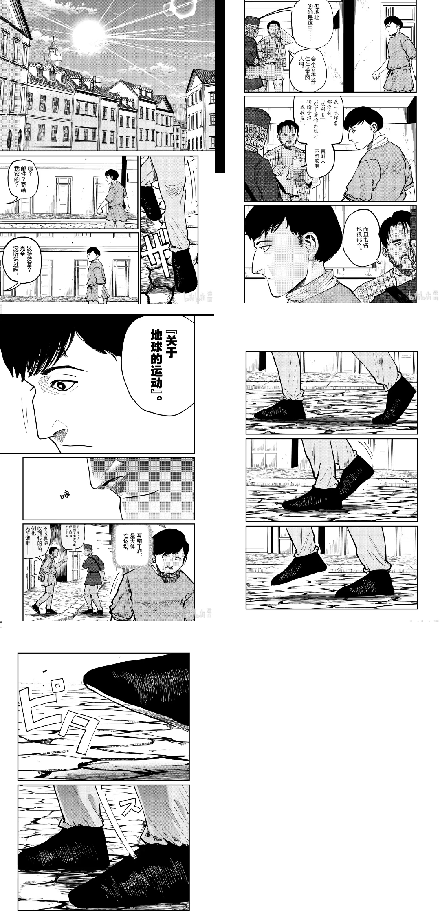
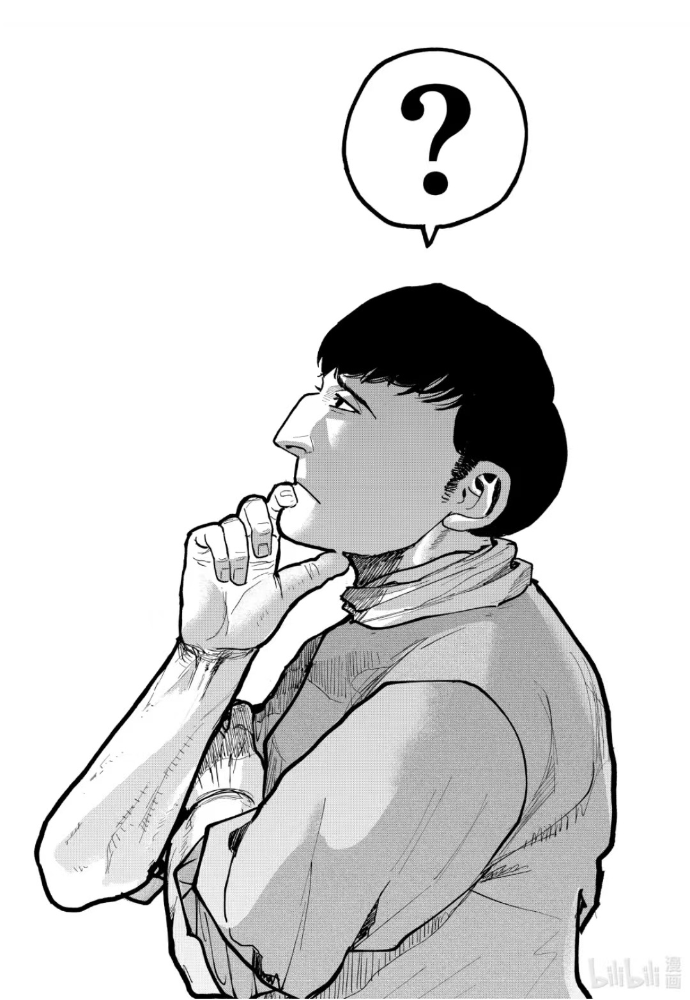

# Good time for Math

## 省流版

AI 越强，越值得去学数学、写算法、做自己感兴趣的研究。理由有三个：

1. **快乐在过程里。** 做数学不只是为了交出正确答案，理解一个巧妙思路、迎来 aha moment，本身就值得；不正确，也不代表毫无意义。
2. **方便不等于安逸。** AI 可以帮忙，但基本功和判断力仍要自己练。它应该是 assistant，而不是 navigator；完成任务之外，更重要的是自己学到了什么。
3. **把省下来的力气用来创造。** 有了 AI，更值得锻炼想象力，以及发现、提出和清楚定义问题的能力。我不想因为担心被替代，就放弃探索的乐趣。

希望自己一直能被有趣的事情感动，也能创造一些感动他人的 funny stuff。

## intro

记得第一次参加实验室的聚餐，也是在电科的唯一一次组内大型聚餐，当时我坐在导师旁边，问了一个比较冒犯的问题，“老师您本科是学数学的，为什么之后转去neuroscience了？”，老师的回答我至今和同学扯淡说做什么什么事情不太有前途的时候都会拿出来引用——“数学/XX是一将功成万骨枯的领域”。这个视频里面提到，OpenAI发布了若干项数学成果后，很多数学家或从事数学相关工作的人都感到悲观，有些人可能用了一辈子在证明的proof一夜之间被AI给出来了，这确实看起来有“一将功成万骨枯”的既视感，但这是唯结果论的视角下得出来的结论，从过程来看其实做数学的收获远不止最后cum的几滴证明材料，**do math/science本质上和masturbate/coitus是类似的，是人用自己的science pennis/pussy去怼/含 自然存在的或别人提出了的science pussy/pennis，带来快乐的大部分是过程而非达到高潮的那一瞬**。

## 4 fun

首先，我个人觉得，做数学和写算法确实是一种艺术享受，而且灵光一现的那个aha moment是比jerk off的时候还爽的。回想起大二打ACM的一个晚上，写代码写累了去厕所捣鼓了一会儿，那是我第一次觉得手艺活没意思，只觉得它是为了让我休息一会儿能够继续fuck algorithm, that hot slut的love potion😍。

但是这种乐趣不太容易找到同好（可能是大家都太忙了？），研究生刚入学的时候上组合数学，课堂上有人提出了一种更快计算重排列的在直觉上更加creative的方式，我当时没听懂，课下用笨办法一步一步推导来帮助自己理解这个insightful method，大致意思就是R-1个元素的重排列和R个元素的重排列的个数是一致的。原题如下：

（题目与推导见下方 Figure 1、Figure 2。）

那个同学提出的方法是直接考虑A，B，C组成的6个字母的符号，因为A，B，C容许的最大次数加和刚好为6，那么这就是一个重排列，计算为6 * 5 * 4 * 3 * 2 * 1/ （2 * 1）* 1 * （ 3 * 2 *1） = 60，这里的直觉是A、B、C的6个元素的重排列和A、B、C的5个元素的重排列的个数是一致的，再浅显一些就是

1. 满足“A至多出现2次，B至多出现1次，C至多出现3次”的6个字母符号，无论删去哪一个字母形成的5个字母的符号依旧满足“A至多出现2次，B至多出现1次，C至多出现3次”这个条件
2. 重排列个数关于元素个数是单调不减的，即满足“A至多出现2次，B至多出现1次，C至多出现3次”的6个字母符号的个数是 ≥ “A至多出现2次，B至多出现1次，C至多出现3次”的5个字符个数的
3. 所以直接用6个字符的情况利用重排列的计算公式即可快速得出5个字符的结果，而避免老师给出的中规中矩，一板一眼，没有什么创意的“分类讨论法”

  <figure><figcaption>Figure 1 · 组合数学原题</figcaption></figure>
  <figure><figcaption>Figure 2 · 手写推导</figcaption></figure>

嘿嘿，其实我刚刚复述这个过程才第一次从直觉上明白为什么这个直觉是对的。据此，我认为数学的快乐可以分为3个层次：

1. 应用公式一板一眼得出严格正确的结果这种concrete的快乐，有点像照着图纸玩胶
2. 被别人的灵光一现感动，但是还没懂，通过形式化证明得出数学上严格成立的结论的过程，有点像从头写代码复现
3. 从简单的逻辑思考体悟到别人的灵光一闪为什么会是成立的，这就是aha moment

从这个3个层次出发的话，我觉得高中的我审美非常高啊。我非常不喜欢也不擅长do calculation和分类讨论的问题，非常的无聊，纯体力活，但是我当时也没有足够的本领做到每道题都给出aha moment的解法，哈哈，所以数学成绩不上不下的。不过，如果考试没有时间限制和分数要求，我应该会花很多时间去想，以前物理老师说“我们现在的高中生思考的时间太少了”，这句话是没问题的。

回到找不到同好这件事上，我承认我通过数学形式化过程得到的证明比较丑陋，但是发到“组合数学1班2025”群里面没有一个人鸟我还是让我有点伤心的😟，在这个上组合数学的班上，没有人（包括老师）care这个东西。然后这形式化证明也不太符合我的审美，让我敝帚自珍也自珍不起来(悲)。“一个东西必须be useful and correct才有意义”这种态度，让我有些反感。

不禁想起《チ。关于地球的运动》里面有一段非常震撼的剧情，大致是一个信奉地心说的老登，观星了一辈子，被主角团讲解了日心说折服后交接他攒了一辈子的基于地心说的观星材料时，他握住那把打开资料室大门的钥匙迟迟不松手，问了神父巴德尼（第二代主角，完善了日心说甚至后面发现地球轨道实际上是椭圆）：”我的研究是徒劳吗“（出自漫画21话，所以如果你被这段话感动了，决定去看这部漫画，可以送我一套实体漫画的全集，我会认你做我没有血缘关系的儿子），巴德尼给出的答案是：“不正确，不代表没意义”。

回到视频里面提到的”there is a certain joy, a certain artistic pleasure to doing it"，做数学和写算法题就是因为过程让人愉悦，可能证明过程有纰漏，算法写好后最后也不work，但是也绝非**毫无意义**，过程中的那一份快乐和感动已经足够。

## 锻炼能力

视频里面提到AI时代锻炼个人能力的问题，先讲讲我最近用AI的体感吧，我用AI做老师吩咐的调研和论文的代码实现以及跑实验，结果前者做出来的是简单罗列材料的PPT，后者是看不懂数据流的冗杂的代码和一大坨实验脚本，然后被老师说“可以用AI进行整理，但是也得有自己的思考和能力的锻炼”，被师兄提醒我太依赖codex了😂，事实也确实如此，重要的不是完成布置的任务，而是通过完成这个任务锻炼自己的能力，有了足够的基本功，才有对AI generated content的判断力，而AI应该充当的角色始终是assistant而非navigator。用不用AI一劳永逸和用魔法生火还是用打火石生火这个问题差不多：

用魔法生火确实快，但是万一遇到没法用魔法进行生火比如魔力耗尽，对魔法过敏这些确实存在的情况时，掌握基本的生火方法就是必要的，用不用魔法/AI谋求便利是一个问题，用魔法/AI一劳永逸而取代对基本能力的锻炼则是另外一个问题，**“方便”和“安逸”不是一回事**。所以，即使AI在各个方面的都远胜于人类，就如同魔法相较于打火石，并不意味着学会用打火石生火就没有意义了。基于这个考量和导师&师兄的训斥，我前段时间就寻求了一些本科低年级同学来和我一起进行科研学习，通过这个过程一方面锻炼自己的基本功，一方面也提炼出research需要的能力和培养一个合格的researcher的完整过程，期望能够构建出一套像[北京大学编译实践课程在线文档 | 北大编译实践在线文档](https://pku-minic.github.io/online-doc/#/)那样人人都能动手去开展的step by step的科研入门教程，让任何人都轻松地踏入research的领域，研究自己感兴趣的问题，make it possible to research everything for everyone。

  <figure></figure>
  <figure></figure>

虽然要锻炼基本功，掌握怎么用打火石，但是有了魔法，我们也应该做好步入“高魔世界”的准备。一方面是没有什么创新性只会造轮子的越来越不受待见，一方面是AI确实可以像魔法一般为大部分普通人代劳繁杂耗时的打火石生火这类体力活，所以我认为AI的出现更好的激发了人们进行创造性活动的积极性。现在的我们更需要的是想象力，是发现问题，提出问题和清楚定义问题的能力，也就是爱因斯坦说的“**提出问题比解决问题更重要，因为它需要创造性想象力，并标志着科学的真正进步**”。

## 无法取代

最后回到会不会因为AI的出现导致所有领域都“一将功成万骨枯”这个问题上，它和《枪炮，钢铁，病菌》13章发明乃需求之母里面的QWERTY键盘和美国真空管/日本晶体管的例子有些类似：

1. 如果它侵害了大部分人的既得利益，那么它就不可能替代掉大部分人

2. AI和人本质上存在区别，主流AI方法和大模型本质上都是概率模型，这就涉及到一个可靠性和可解释性的问题，而且AI生成的内容存在是AI可读但是人类难懂的窘境，这一批东西的审核也需要专业人士来进行人工处理。

   如果真出现像超能查派或者底特律变人那样的存在，我觉得会先出现因为AI失业的人的抗议运动belike：

   

   然后AI本身这时也会作为一种新的creature存在而不是tool，产生和人一样的诉求，也会有AI工会，要求同工同酬之类的doge。总之我不觉得AI会替代人类，也不会悲观的担心做的事情到某天就突然“一将功成万骨枯”了。

   

   将思路逆转吧，因为AI的出现，There‘s never been a better time to go into any field。

最后用我最喜欢的一个神分镜结尾（写前面balabala一大堆东西其实就是想放这段图）：

希望自己能一直被有趣的事情感动，也能创造一些感动他人的funny stuff，永远在路上，永远热泪盈眶。